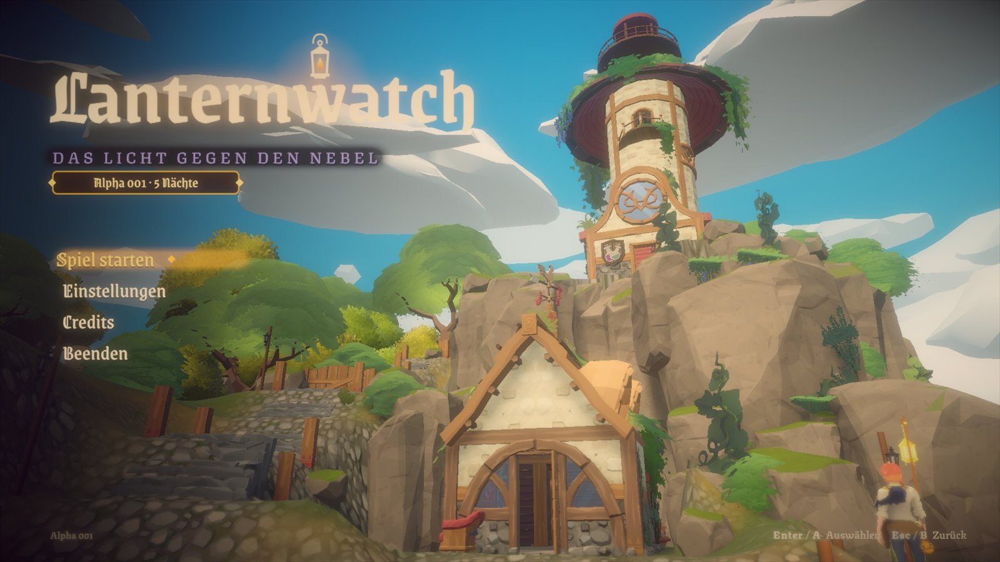
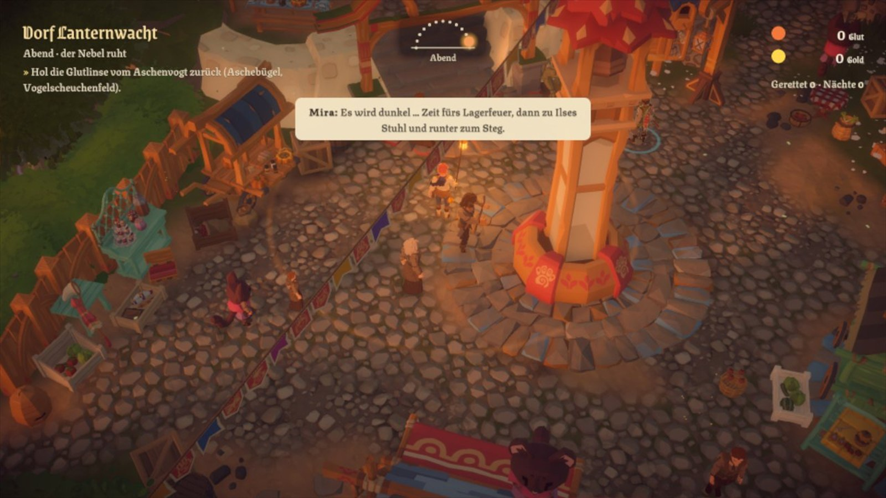
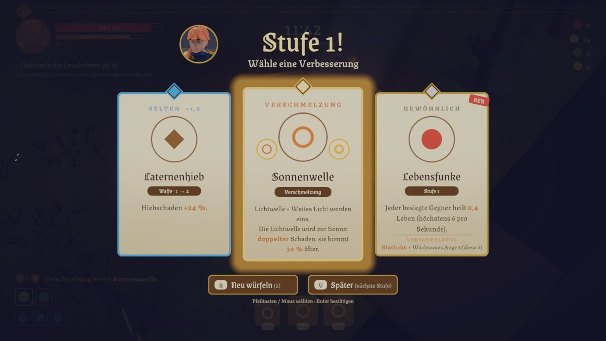
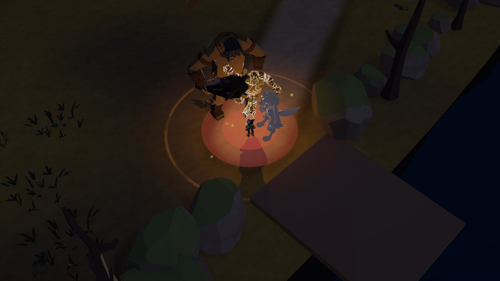
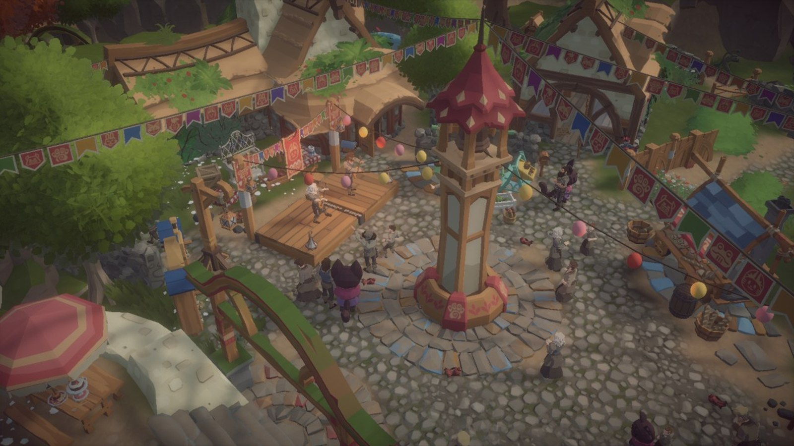

  <picture>
    <source media="(prefers-color-scheme: dark)" srcset="images/logo_wordmark.png">
    
  </picture>

<b>Alpha 001</b> · Ein Spiel von One Candle Games

<a href="../../releases/latest"><b>Neueste Version herunterladen</b></a>

Nachts trägst du als Mira eine Laterne durch den Nebel, entzündest Leuchtfeuer und rettest verlorene Dorfbewohner. Tagsüber baust du das Dorf am Leuchtturm wieder auf. **Lanternwatch** ist ein isometrisches Horde-Roguelite mit gemütlichem Dorf.

**Alpha 001** umfasst fünf Nächte auf dem Aschebügel. Die Texte sind auf Deutsch.

| | |
|---|---|
|  |  |
|  |  |
|  | |

## Neu in Alpha 001
- **Start und Tutorial:** kurzes Tutorial, das sich überspringen lässt. Der Einstieg beginnt in Ilses Haus an der Leuchtturm-Klippe.
- **Tag und Nacht:** 12 Minuten Nacht, 12 Minuten Dorf-Tag mit wandernder Sonne, abends Lagerfeuer am Kai.
- **Dorf und Figuren:** Alle erzählen etwas, es gibt ein Dorffest und Hennicks Funkenglas. E zum Reden, Q zum Handeln.
- **Kampf und Karten:** sichere Verschmelzungen und „Meine Karten“ (Tab). Mira hat jetzt 50 Leben.
- **Gegner:** Glutgolems, Werwolf-Mini-Bosse, der Aschenriese und die Krähenschwärme des Aschenvogts.
- **Aussehen und Name:** neuer Name Lanternwatch, neues Logo und Studio One Candle Games.

## Starten
1. ZIP von der [Release-Seite](../../releases/latest) herunterladen und vollständig entpacken.
2. `Lanternwatch.exe` doppelklicken.
3. Die Datei ist nicht signiert, deshalb kann Windows beim ersten Start eine Warnung zeigen. Lade das Spiel nur von der Release-Seite dieses Projekts herunter.

## Steuerung
WASD laufen · Leertaste ausweichen · Q Aufflammen · E Brandflasche · F heimkehren am Leuchtfeuer · Tab Meine Karten · im Dorf E reden, Q handeln, M Dorfkarte · F8 bei Feststecken · Esc Pause.
Maus und Tastatur empfohlen. Controller funktionieren, sind aber noch nicht vollständig getestet.

## Bekannte Probleme
Siehe Release-Notizen: Platzhalter-Geräusche, Controller noch nicht vollständig getestet, die exe ist nicht signiert.

---

**English:** Lanternwatch is an isometric horde roguelite with a cozy village hub. Alpha 001 covers five nights on Ashhill. The game text is German only for now. Download the ZIP from the [latest release](../../releases/latest), unzip it and run `Lanternwatch.exe`. The exe is not signed, so Windows may show a warning. Stuck? Press F8.

© One Candle Games. Dieses Repository enthält nur Bilder und Texte, keinen Quellcode und keine Spieldateien.
