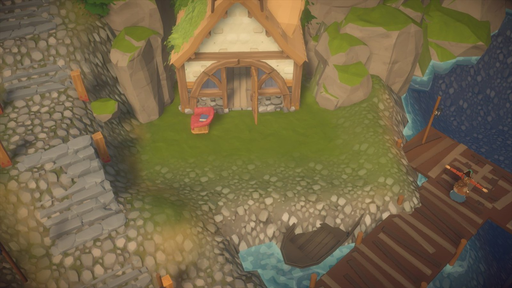

  <picture>
    <source media="(prefers-color-scheme: dark)" srcset="images/logo_wordmark.png">
    
  </picture>

<b>Alpha 001</b> · A game by One Candle Games

<a href="../../releases/latest"><b>Download the latest version</b></a>

At night you carry Mira's lantern through the fog, light beacons and rescue lost villagers. By day you rebuild the village by the lighthouse. **Lanternwatch** is an isometric horde roguelite with a cozy village hub.

**Alpha 001** covers five nights on Ashhill. In-game text is German for now.

| | |
|---|---|
|  |  |
|  |  |
|  | |

## New in Alpha 001
- **Start and tutorial:** a short tutorial you can skip. The story begins in Ilse's house at the foot of the lighthouse cliff.
- **Day and night:** 12-minute nights and a 12-minute village day with a moving sun; evenings at the campfire on the quay.
- **Village and characters:** everyone has something to say, there's a village festival and Hennick's spark glass. E to talk, Q to trade.
- **Combat and cards:** guaranteed fusions and "My Cards" (Tab). Mira now has 50 health.
- **Enemies:** ember golems, werewolf mini-bosses, the Ash Giant and the Ash Warden's crow swarms.
- **Look and name:** new name Lanternwatch, new logo and the studio One Candle Games.

## How to start
1. Download the ZIP from the [release page](../../releases/latest) and unzip it completely.
2. Double-click `Lanternwatch.exe`.
3. The exe is not signed, so Windows may show a warning on first launch. Only download the game from this project's release page.

## Controls
WASD move · Space dodge · Q flare · E fire flask · F return home at a beacon · Tab My Cards · in the village E talk, Q trade, M map · F8 if you get stuck · Esc pause.
Mouse and keyboard recommended. Controllers work but are not fully tested.

## Known issues
See the release notes: placeholder sounds, controllers not fully tested, the exe is not signed.

---

© One Candle Games. This repository only contains images and text — no source code and no game files.
