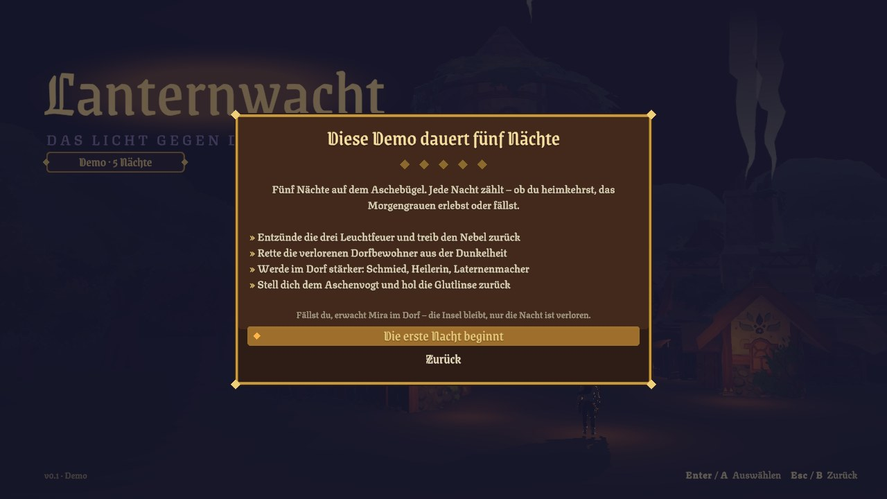
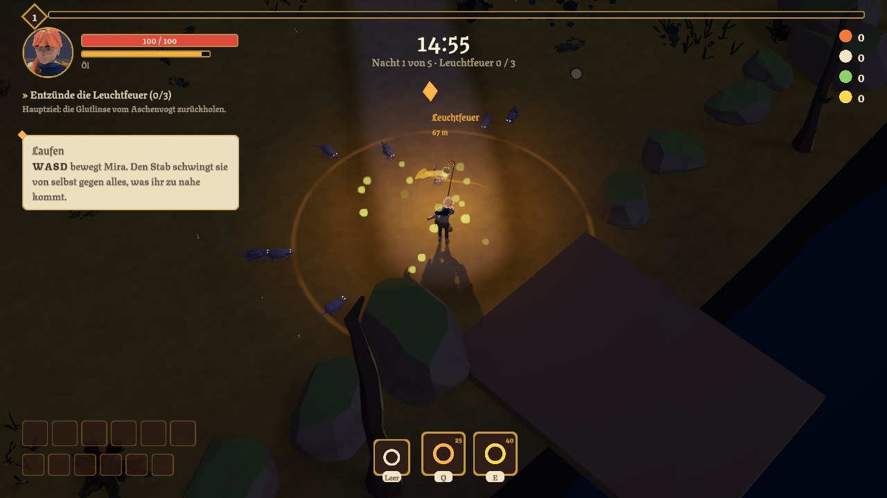
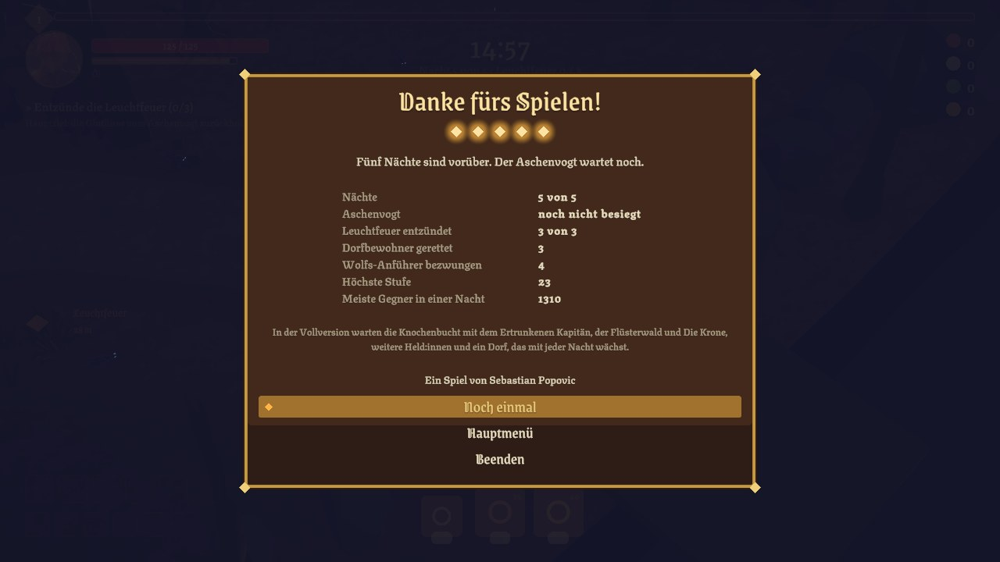

# Lanternwacht – Demo (5 Nächte)

**[⬇ Demo herunterladen (Windows, ~300 MB)](https://github.com/0815Popo/lanternwacht-demo/releases/latest)**

Mira hält mit ihrer Laterne den Nebel zurück. Fünf Nächte lang auf dem Aschebügel: Entzünde die drei Leuchtfeuer, rette verlorene Dorfbewohner, werde im Dorf stärker – und stell dich dem Aschenvogt, der in der dritten Nacht erwacht.

Die Demo dauert **fünf Nächte** (bis zu ca. 75 Minuten). Jede Nacht zählt – ob du heimkehrst, das Morgengrauen erlebst oder fällst. Fällst du, erwacht Mira im Dorf; nur die Nacht ist verloren.

## Starten
1. Unter [Releases](https://github.com/0815Popo/lanternwacht-demo/releases/latest) die ZIP-Datei laden und entpacken.
2. `Lanternwacht.exe` starten.
3. Die exe ist nicht signiert. Zeigt Windows „Der Computer wurde durch Windows geschützt“, auf **Weitere Informationen → Trotzdem ausführen** klicken. Ist **Smart App Control** eingeschaltet, startet die Demo leider nicht.

**System:** Windows 10/11, 64 Bit, DirectX 11.

## Steuerung
| Aktion | Tastatur | Controller |
|---|---|---|
| Laufen | WASD | linker Stick |
| Ausweichen | Leertaste | A |
| Aufflammen | Q | LB |
| Brandflasche | E | RB |
| Heimkehren am Leuchtfeuer | F | Y |
| Benutzen im Dorf | E | X |
| Pause | Esc | Start |

## Hinweise
- Frühe Demo: Die Töne sind Platzhalter, Musik gibt es noch nicht.
- Der Spielstand der Demo wird lokal gespeichert.

Ein Spiel von **Sebastian Popovic**.

3D-Assets © Synty Studios, lizenziert für dieses Spiel. Sie dürfen nicht aus dem Spiel entnommen oder weiterverwendet werden.

---

### English
Lanternwacht is a 5-night demo: hold back the fog with Mira's lantern, light the three beacons, rescue villagers and defeat the Ashwarden (Aschenvogt). Download the ZIP from [Releases](https://github.com/0815Popo/lanternwacht-demo/releases/latest), unzip, run `Lanternwacht.exe` (Windows 64-bit). The exe is unsigned: on the SmartScreen warning click *More info → Run anyway*; it will not start with Smart App Control enabled. The game is in German. Early demo with placeholder sounds and no music yet. 3D assets © Synty Studios, licensed for this game only – do not extract or reuse them.
