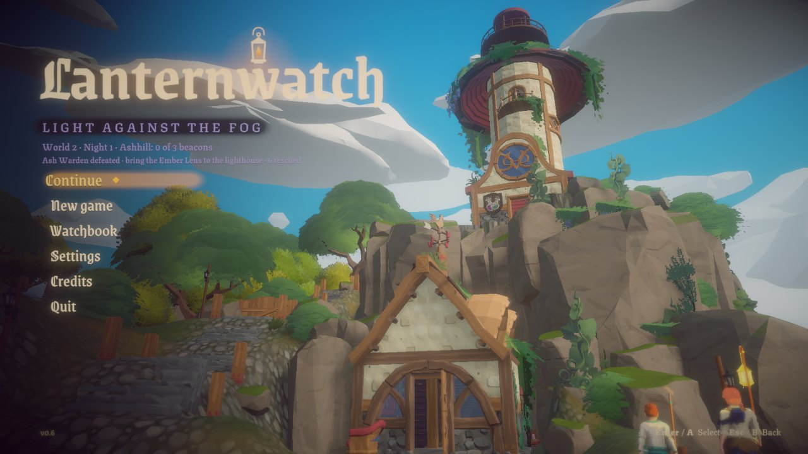
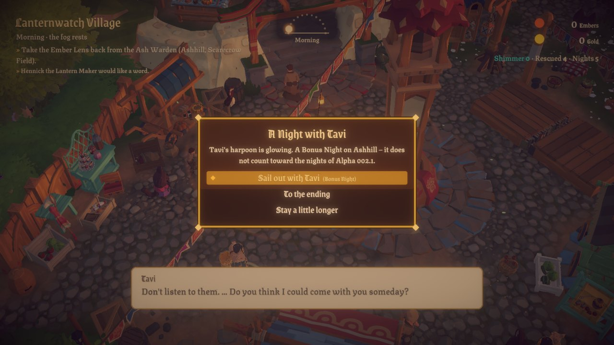
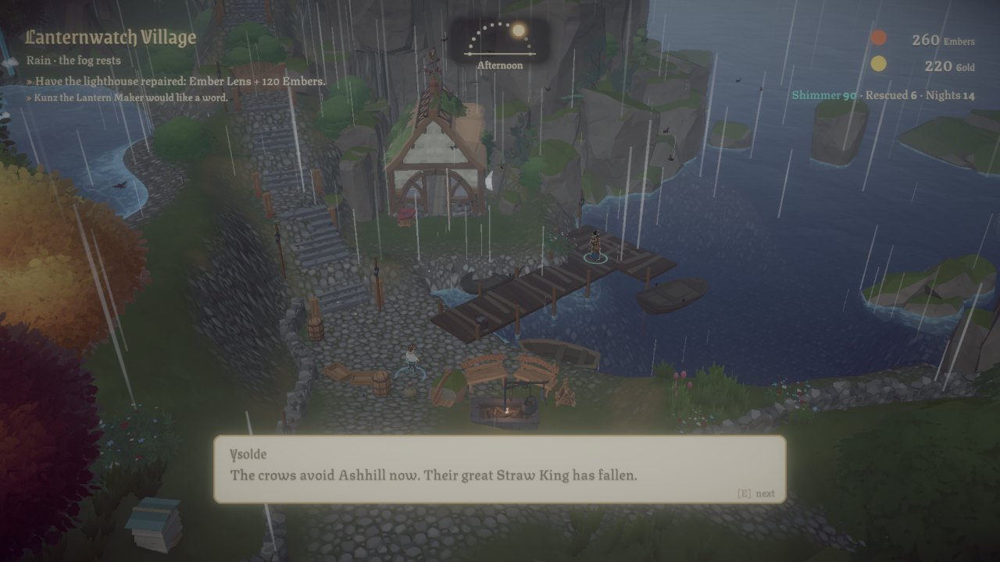
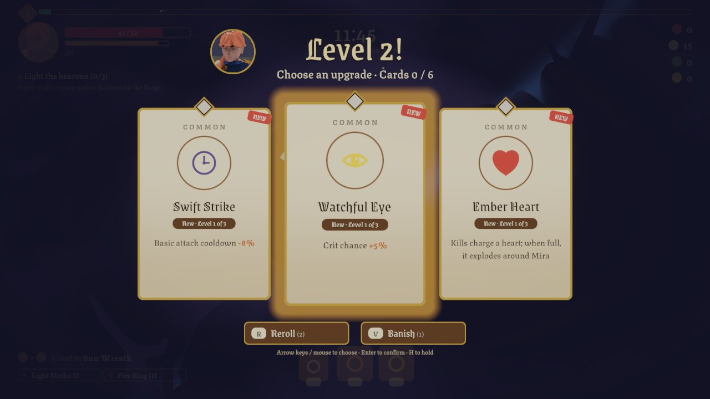
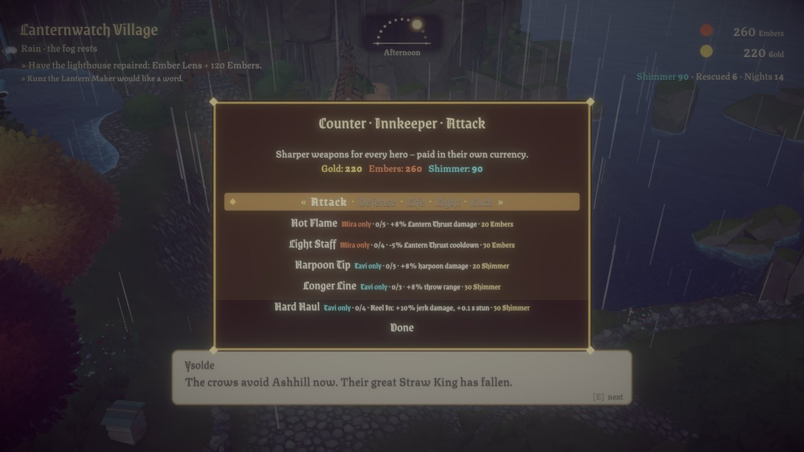
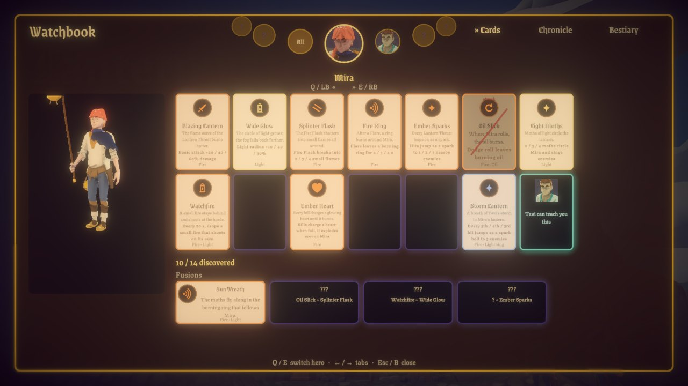

  <picture>
    <source media="(prefers-color-scheme: dark)" srcset="images/logo_wordmark.png">
    
  </picture>

<b>Alpha 002.1</b> · A game by One Candle Games

<a href="../../releases/latest"><b>Download the latest version</b></a>

At night you carry Mira's lantern through the fog, light beacons and rescue lost villagers. By day you rebuild the village by the lighthouse. **Lanternwatch** is an isometric horde roguelite with a cozy village hub.

**Alpha 002.1** covers five nights on Ashhill, then a bonus night with Tavi, the fisher's apprentice. The whole game is now in English.

| | |
|---|---|
|  |  |
|  |  |
|  | |

## New in Alpha 002.1
- **The game is now fully in English** – menus, dialogue, cards, tutorial, logbook and the Watchbook.
- **Tavi's morning:** after every night he waits on the shore and runs up to Mira first.
- **Tavi's storm cards:** Thunderbolt, Salt Crust, Storm Eye and Breakers.

## New in Alpha 002
- **Tavi, a second hero:** after the five nights a spark wakes him at the harbour, and you get one bonus night with his harpoon, net and storm lightning.
- **Ember path:** the way to the next beacon shows in the fog itself. Hold Shift / LT for the Ember call, a lane of light through the fog.
- **New card system:** at most 6 cards per night, 3 levels each, fusions at level 3. Rarities from weak to heroic, card editions, hold and reroll.
- **Tavern counter and Watchbook:** every purchase at the tavern counter; your cards, a chronicle of your nights and a bestiary in the Watchbook.

## How to start
1. Download the ZIP from the [release page](../../releases/latest) and unzip it completely.
2. Double-click `Lanternwatch.exe`.
3. The exe is not signed, so Windows may show a warning on first launch. Only download the game from this project's release page.

## Controls
WASD move · Space dodge · Q flare · E fire flask · hold Shift Ember call · F return home at a beacon · Tab My Cards · in the village E talk, Q trade, M map · F8 if you get stuck · Esc pause.
Mouse and keyboard recommended. Controllers work but are not fully tested.

## Known issues
See the release notes: placeholder sounds, card and lightning balance not final, controllers not fully tested, the exe is not signed.

---

© One Candle Games. This repository only contains images and text — no source code and no game files.
